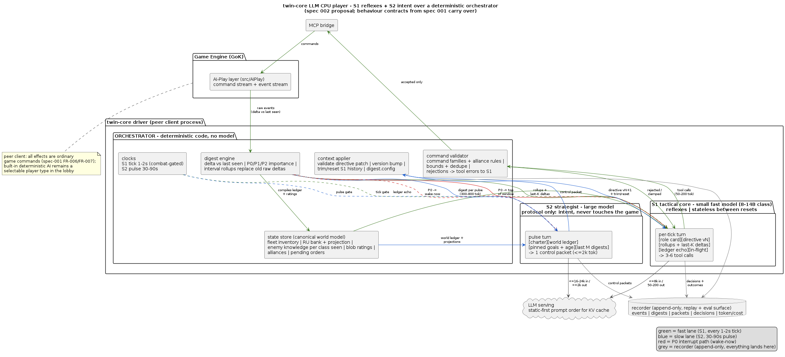

# Two-Model LLM CPU Player — Architecture Design ("Twin-Core")

**Status**: Proposed design (no code yet — will be formalised as spec 002 via the SDD
workflow before implementation).

**Companion documents**: The CPU behaviour this system re-imbodies is fully specified
in `specs/001-cpu-player-intelligence/spec.md` (contracts) and
`specs/001-cpu-player-intelligence/baseline-reference.md` (data inventory); the human
equivalent strategy guide is `documentation/community/cpu-player-playbook.md`.

---

## 1. The idea in one paragraph

A CPU player driven by two cooperating LLMs. A **fast small model** ("S1", the
tactical core) is the only component that touches the game through the MCP command
interface: it watches a live event stream and issues the actual game commands every
tick. A **large strategic model** ("S2", the strategist) never touches the game and
never sees raw events; it pulse-driven manages S1's context — rewriting S1's
directive slot, trimming/resetting its conversation history, adjusting priorities,
issuing standing orders — and receives compacted, sanitised digests of what happened.
S1 is reflexes; S2 is intent.

## 2. Why this maps onto the game's existing AI

The 1999 AI already is a two-layer cognitive architecture. The design is a
deliberate re-embodiment of it, so behaviour contracts from spec 001 carry over:

| Game AI (existing, C) | Twin-core LLM system | Layer |
| --- | --- | --- |
| `teams + moves + event handlers` (49 actions, 14 watchdogs, per-tick reactions) | **S1 tactical model** — per-tick loop, tool calls, reflexes embedded in prompt+weights | fast |
| **Managers** (resource / attack / defence, running every think) | Shared: deterministic code in the orchestrator where mechanical (economy), S1 prompt-policy where judgemental (combat) | fast |
| **Tweak tables** (`AIA_*_PROB`, feature flags, build split 30/30/40, sphere sizes) | **S2-owned directive document** (validated JSON, a mutable slot of S1's system prompt) | slow |
| **Fleet command cycle** (`aifFleetCommand` fixed think order) | **Orchestrator** (deterministic shim — NOT an LLM): clocks, tick gating, digest engine, state store | n/a |
| **Fleet-command strategy** (primary enemy, RUs for hyperspace, CPU politics) | **S2 strategic model** — goals, budgets, doctrine, politics | slow |
| **KAS mission scripting** (script teams, states, `aivar` interlocks) | S2's control protocol, which behaves like a script actor over S1 | slow |
| **`enemyShipsIAmAwareOf` + blob rating** | **State store** (entity registry + knowledge + ratings compiled by code) feeding both models | n/a |
| **Global AI variables (`aivar`)** | **State store** slots S1/S2 can read/write through the orchestrator | n/a |

## 3. Components



*Source of truth: [`llm-cpu-player-two-model-design.puml`](llm-cpu-player-two-model-design.puml)
(render with: `java -jar plantuml.jar -tpng llm-cpu-player-two-model-design.puml`).*

The detailed flow diagrams in section 4 remain in ASCII so diff/review stays easy.

### 3.1 Orchestrator (deterministic code — the "nervous system")

Everything time-shaped belongs to code, not a model:

- **Clocks**: S1 tick gate (every ~1-2s of game time; faster on combat intensity),
  S2 pulse (every 30-90s, or immediately on a P0 interrupt).
- **Digest engine**: the sanitiser/compactor for the event stream — interval
  bucketing, dedupe, importance classification (P0 break-interrupt / P1 next-delta /
  P2 rollup-only), fixed-schema digests, and interval rollups that replace old raw
  deltas in S1's ring window.
- **State store**: canonical world model — own fleet inventory/unit states, RU bank
  and projected income, enemy knowledge (per ship class seen, like
  `enemyShipsIAmAwareOf`), blob ratings/compositions, alliance state, pending
  orders and their statuses. Both models reference *this*, never their own memory
  of the battlefield.
- **Command validator**: every S1 tool call is checked against the command
  interface (the ~121 mapped commands), alliance rules ("never attack allies"),
  bounds, duplicates; invalid commands are rejected with reason and fed back to S1
  as tool errors.
- **Recorder**: append-only log of raw events (ring-buffered), digests, S2 writes,
  S1 decisions + outcomes, token/cost accounting. This is the replay and debugging
  surface — the equivalent of `/aiplayerLog` but complete.

### 3.2 S1 — tactical core (fast small model)

- **Job**: per tick, turn (directive + latest deltas + open orders) into command
  calls; react to P0 interrupts immediately.
- **Context anatomy** (hard budget, e.g. 8k tokens steady-state):
  1. *Static role card* — who it is, interface cheatsheet, constraints, veto rules.
  2. *Mutable directive slot* (0.5-1.5k) — S2-owned JSON (goals, priorities, build
     split, defensive posture, standing orders). The ONLY prose-ish place S2
     regularly rewrites; patched, versioned, never wholesale.
  3. *Rolling event window* — last K tick deltas + the newest interval rollup lines
     (older deltas evaporate into rollups, never accumulate).
  4. *Live state echo* — ledger snapshot line per fleet group/economy.
  5. *In-flight* — current orders + their statuses.
- **Does not**: hold long-term memory (resets are cheap by design), see raw
  high-frequency streams, decide strategy, or bypass the validator.

### 3.3 S2 — strategist (large model)

- **Job**: intent. On each pulse it reads (ledger + pinned goals + last M digests +
  its own previous plan and outcomes) and writes a **control packet**:
  - `directive.patch` — S1's mutable slot, schema-validated JSON
  - `orders` — standing orders with priority, TTL and abort conditions
  - `history` ops — trim scope or full `reset_history(seed_state)` for S1
  - `digest.config` — what to emphasise/suppress next cycle (its "attentions")
  - `questions` — targeted observation requests the orchestrator answers from the
    state store next digest ("enemy base layout?", "RU projection?")
- **Never**: issues a single game command, sees raw events, or talks to S1
  freeform. All influence is through the protocol; this is what keeps S1
  fast and S2 cheap.
- **Sticky goals**: at most one `primary_enemy` and a small set of pinned
  objectives; change requires evidence + minimum-hold times (hysteresis), per
  spec-001 FR-050 (no rubber-banding: S2 adapts to the game, not to human mood).

## 4. Data flows

### 4.1 Steady-state S1 loop (per tick)

```
game events --(MCP observe, delta vs last seen)--> digest bucket (raw ring)
   -> S1 input: [role card][directive vN][rollups + last K deltas][ledger echo][orders]
   -> S1 emits tool calls (subset of ~121 commands)
   -> orchestrator validates (interface + allies + bounds + dedupe)
   -> accepted -> MCP bridge -> command stream (game)   | rejected -> tool error back to S1
   -> command ledger; event consequences return next tick
```

### 4.2 S2 pulse (every N seconds, or woken by P0)

```
digest ring (30-90s of ticks) --> digest engine compacts --> digest (300-800 tok)
   -> S2 input: [charter][world ledger][pinned goals + provenance/age]
                [last M digests + milestones][own last plan + outcomes]
   -> S2 emits control packet
   -> orchestrator: schema-validate directive -> version bump
      -> apply at next S1 tick boundary (trim/reset S1 history)
   -> S2's questions -> answered from state store next pulse
```

### 4.3 Interrupt path (P0: base invaded, fleet annihilated, no command centre)

```
event classifier (P0) ->  (a) inject into S1 immediately (next tick, top of window)
                          (b) wake S2 now (async), not just at next pulse
                          (c) S1 emergency veto applies even against S2 orders,
                              reported in the next digest ("violated hold order, reason")
```

### 4.4 History management (S2 as S1's context manager)

- **Trim**: roll up deltas older than K ticks into 1-2-line interval rollups; cap
  the ring; drop P2 chatter first, P1 next, never P0.
- **Reset**: on directive version bumps that change doctrine, S1's conversation
  collapses to `[role card + directive vN + state seed + in-flight orders]` — S1
  is *stateless between resets by design*, every durable memory belongs to the
  state store, so resets are safe and frequent.
- **Patch, not rewrite**: directives carry `version` and semantic patches; the
  recorder keeps a full revision history (audit = scroll).

### 4.5 Economics of context

| Channel | Volume target | Discipline |
| --- | --- | --- |
| Raw event ring (code) | unbounded, ring-buffered | never shipped to a model raw |
| S1 tick input | ≤ ~8k tokens | static+directive cached first (KV-friendly), mutable late |
| S1 tick output | ~50-200 tokens (a few tool calls) | validator rejects freeform rambling |
| Digest per pulse | 300-800 tokens | fixed JSON schema; importance-gated |
| S2 pulse input | ≤ ~16-24k tokens (ledger + M digests) | milestones compress digests older than M |
| S2 pulse output | ≤ ~1-2k tokens (one control packet) | single JSON document, schema-validated |

## 5. Protocol shapes (key schemas)

- **Directive** (S1's mutable slot, S2-owned):
  `primary_enemy`, `doctrine` (defence tiers, harass cadence, attack aggression),
  `build_split` (mirrors the 30/30/40 budget), `standing_orders[]`
  (id, kind, target, priority, TTL, abort conditions), `attentions`
  (what to watch and how loudly to react), `version`.
- **Digest** (S2-facing): `interval`, `tick_range`, `p0[]` (verbatim, urgent),
  `changes[]` (fleet composition deltas, RU flow, losses/built, enemy sightings
  with ship classes, alliance events), `order_status[]`
  (completed/failed/overridden + why), `s1_notes` (S1's one-line "why it
  disobeyed / what surprised it"), `projections[]` (RU income, threat estimate).
- **Standing order**: `id`, `verb` (from command families), `subject`,
  `constraints`, `priority`, `TTL`, `abort` (S1 may abort with report), `veto`
  (may S1 suspend it under emergency? — default yes).
- **Validator result**: `ok` / `rejected(reason, hint)` / `clamped(original
  -> corrected)` — rejections flow back to S1 as first-class tool errors so it
  learns the interface in-loop (no silent swallowing).

## 6. Deliberate design choices & the failure modes they prevent

| Risk | Prevented by |
| --- | --- |
| S1 context bloat (the "gets overrun" problem) | ring window + rollups + frequent cheap resets; durable memory lives in the state store, not S1's history |
| S2 reacting to narrative hallucinations it wrote earlier | S2 reads a code-compiled ledger, digests are schema-validated; S2's claims must cite ledger numbers |
| Strategy oscillation (every digest suggests a new plan) | sticky `primary_enemy` + pinned goals + minimum-hold + evidence thresholds |
| S2 latency vs real-time game | standing orders keep S1 self-sufficient between pulses; S2 sets doctrine, never micro |
| S2 trying to micromanage (becomes a straitjacket) | order abstraction has TTL + S1 emergency veto + required `s1_notes` reporting |
| Invalid/impossible commands | command validator with friendly rejections (interface learned in-loop) |
| Token cost blowups | fixed budgets per channel; static-first prompt layout for KV cache; S2 pulse gating |
| Un-debuggable behaviour | recorder: everything replayable; directive revisions + digests + decisions are first-class artefacts |
| Losing to the 60-minutes-hallway problem (S1 can't "hold") | S1's directive carries doctrine, not tactic-by-tactic orders; tactical judgement stays in the fast loop |

## 7. Determinism, safety, and the built-in AI

- The LLM CPU is a **peer client**: all effects are game commands on the normal
  command stream (spec-001 FR-006/FR-007 apply unchanged). No privileged
  simulation access even though the driver is out-of-process.
- The **built-in deterministic AI stays** — `/determCompPlayer` replays remain
  possible; the LLM CPU coexists as a selectable player type (one more option in
  the lobby CPU count), not as a replacement.
- **Degradation paths**: S2 down → S1 runs on the last valid directive (and a
  ships-dock-and-default-playbook directive is the boot default); S1 down → no
  commands issued (fleet idles); MCP bridge down → both go idle, never guess.
- Difficulty knob: same directive schema, more conservative parameters at lower
  levels; per-level presets derived from the game's own difficulty data
  (baseline-reference.md §1-§4) — the data-driven convention (spec-001 FR-039 in
  spirit) applies here too.

## 8. Suggested model classes & budgets

- **S1**: a small instruction-tuned tool-calling model (8-14B class — plenty on a
  single consumer GPU) at ~1-2s tick with ~50-200 output tokens; total tick cost
  trivial; the point is *constant* input size, so latency never climbs.
- **S2**: a large model (30-70B class or a strong hosted model) at 30-90s pulses
  with ≤2k output; cost per pulse dominated by input (ledger+digests), which the
  milestone compression keeps sub-linear over the match.
- These budgets must be measured, not assumed: the recorder logs token counts per
  channel; budgets are config, and breach = reset+alert, not silent growth.

## 9. Milestones (proposal — becomes spec 002's plan if adopted)

- **M0 — bridge + recorder**: complete the MCP command interface (validate the
  full ~121 command surface, event observation with deltas), append-only recorder
  with replay.
- **M1 — nervous system**: state store, digest engine (P0/P1/P2 classes,
  rollups), S1 loop with a *static* directive, validator. Deliverable: an LLM
  peer that plays the CPU playbook opening and harass runs decently on its own.
- **M2 — the strategist**: S2 pulse loop, directive patching, history
  trim/reset, sticky goals. Deliverable: the full twin-core, with the strategist
  visibly changing doctrine mid-match (e.g. switching primary enemy on evidence).
- **M3 — evaluation**: harness matches: LLM-CPU vs built-in CPU at each level,
  LLM-CPU vs humans, plus regression clips from the recorder; report digest
  cost/latency/win-shape.

## 10. Open questions (for the spec's clarify step)

1. **Economy layer**: keep build/economy purely deterministic code (mirrors
   `AIResourceMan`, saves tokens, hard to misuse) and leave S1 combat-only — or
   make S1 own everything per the "AI plays everything" reading? (Recommendation:
   deterministic economy first; widen S1 later only if needed.)
2. **The ~121 number**: confirm the exact command surface size your MCP maps (the
   game's own interface is ~15 command families / 49 AI action types; 121 is
   plausibly your tool count — the design is indifferent, the validator just
   needs the enumeration).
3. **S1 tick rate vs cost**: 0.5s/1s/2s — measure and pick; combat intensity
   gating (faster under fire) mirrors the game's woodpecker cadence trick.
4. **S2 hosting**: local large model on the 8x3090 rack vs hosted API (latency,
   cost, privacy trade-off).
5. **Personality hooks**: `doctrine` presets (rushy/turtle/balanced) are trivially
   expressible in the directive schema even though baseline spec pins
   personalities out of scope — they arrive free as data here; decide whether to
   expose them in the lobby now or later.